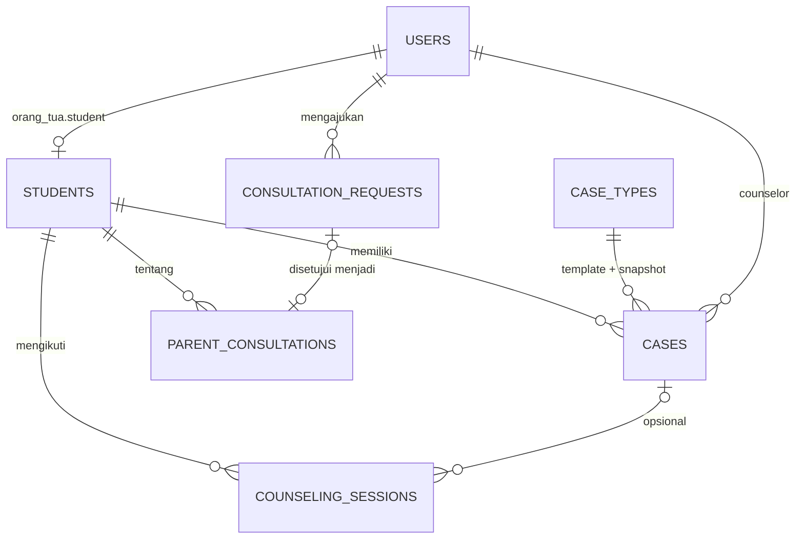

# Rencana Integrasi PocketBase v2 — E-BK SMPN 1 Pabuaran (Hasil Audit Menyeluruh)

## 1. Kesimpulan Audit

**Rencana v1 BELUM sesuai.** Setelah membaca seluruh isi project (±18.400 baris Dart: 4 model, 17 layar, 9 widget), `SRS.xlsx`, konfigurasi Android/iOS/macOS, dan kondisi PocketBase yang sedang berjalan, saya menemukan **19 kekurangan/kesalahan** pada v1. Tiga yang paling kritis:

1. **Kebocoran privasi (RBAC salah).** v1 mengizinkan semua user login membaca `students` dan `cases`. Artinya orang tua mana pun bisa membaca data & kasus **semua siswa**, termasuk nomor HP wali lain. Orang tua harus dibatasi ke data anaknya sendiri (SRS-F-008).
2. **Celah keamanan akun.** Koleksi `users` bawaan PocketBase saat ini punya `createRule` kosong (siapa pun bisa mendaftar sendiri) dan `updateRule = id = @request.auth.id`. Jika field `role` ditambahkan seperti di v1 tanpa dikunci, siapa pun bisa mengubah role-nya sendiri menjadi `guru_bk`.
3. **Cakupan kurang.** v1 tidak punya koleksi untuk **Jadwal Konseling** (SRS-F-005) dan **Pengajuan Konsultasi** (SRS-F-011). v1 juga tidak mencakup **statistik Kepala Sekolah** (SRS-F-012), padahal seluruh dashboard Kepsek dan Detail Analitik masih angka hardcode.

---

## 2. Temuan Audit Terhadap Rencana v1

| # | Temuan | Bukti di project | Dampak | Perbaikan di v2 |
|---|--------|------------------|--------|-----------------|
| 1 | Versi SDK salah (`pocketbase: ^0.19.0`) | `flutter pub add pocketbase --dry-run` meresolusi **0.25.3** | Build gagal / API tidak cocok server 0.40.6 | Pakai `pocketbase: ^0.25.3`, plus **smoke test** SDK↔server 0.40.6 di Fase 1 |
| 2 | Skema `consultations` karangan sendiri | Model asli `ParentConsultationModel`: `consultationMethod`, `topic`, `discussionSummary`, `followUpPlan`, `isCompleted`, dst. | Data tidak bisa dipetakan | Skema dibuat dari field model nyata (§4) |
| 3 | Tidak ada koleksi Jadwal Konseling | `CounselingModel` + `jadwal_konseling_screen.dart` (2.281 baris) | SRS-F-005 tidak terlayani | Koleksi `counseling_sessions` |
| 4 | Tidak ada Pengajuan Konsultasi | `ajukan_konsultasi_screen.dart`: `_handleSubmit` hanya menampilkan toast | SRS-F-011 hanya tampilan | Koleksi `consultation_requests` + alur persetujuan Guru BK |
| 5 | Rule baca terlalu longgar | v1: `@request.auth.id != ""` | Orang tua membaca data semua siswa | Rule per role + scoping `student = @request.auth.student` |
| 6 | Celah `users` (signup publik & eskalasi role) | `_collections.users`: `createRule=''`, `updateRule='id = @request.auth.id'`, 0 user, 1 superuser | Pengambilalihan akun Guru BK | Kunci `createRule/updateRule/deleteRule`, field `role` tidak bisa diubah sendiri |
| 7 | Statistik Kepsek tidak direncanakan | `dashboard_kepsek_screen.dart` & `detail_analitik_screen.dart`: bar chart, `24`, `79%`, `-17%`, ranking "Bagas Pratama" (nama yang tidak ada di data siswa) semua hardcode | SRS-F-012 palsu | Endpoint agregasi `/api/ebk/stats` |
| 8 | Login tidak sesuai SRS | SRS-F-001 "email/NISN"; PocketBase `identityFields: ["email"]`; Kelola Pengguna memakai **username** + `emailOrPhone`; `email` wajib di PocketBase | NISN/username tidak bisa login | `identityFields: [email, username]`, `email` opsional (butuh keputusan Q1) |
| 9 | Tanggal berupa teks bebas & ID dibuat di klien | `incidentTime: 'Kamis, 05 Nov 2026 • 10:15 WIB'`; ID `'KSL-0${length+1}'`, `'#BK-2026-0${50 + second % 40}'` | Tidak bisa difilter/diurutkan/dihitung; **ID bisa bentrok** | Field `date` asli + `code` dibuat server (hook) + formatter `id_ID` |
| 10 | Data seed tidak konsisten | NISN Rizky = `0094821034` (siswa/kasus) vs `0081234567` (konseling/akun/profil); Alya `0103948219` vs `0098765432`; Dimas `0112839401` vs `0105678912`; Farhan, Siti, Budi **tidak ada** di daftar siswa | Relasi antarkoleksi tidak mungkin | Seed disatukan: satu master siswa (§6) |
| 11 | Angka/teks hardcode di UI | `'640 Siswa'`, `'8 Proses'`, `'5 Jadwal'`, `'3 Pesan'`, `'640 Akun'`, `'08'`, `'05'`, `'Sabtu, 7 Nov 2026'`, `TP 2026/2027`, `Semester Ganjil`, sapaan ortu "Ibu Siti Rahma / wali Rizky" vs profil "Bpk. Hendra / wali Ahmad Fauzi" | Data palsu terlihat user | Semua dihitung/diambil dari backend |
| 12 | Profil belum nyata | `profil_view.dart`: nama/NIP/email/HP hardcode per role; foto = URL Unsplash simulasi; toggle notifikasi tidak disimpan | SRS-F-002 & profil tidak berfungsi | Profil dari `authStore.record`, upload `avatar`, simpan preferensi |
| 13 | Konfigurasi platform belum siap | Izin `INTERNET` hanya di `debug`/`profile` manifest (tidak di `main`); tidak ada `usesCleartextTraffic`; iOS `Info.plist` tanpa ATS/izin foto; macOS `Release.entitlements` tanpa `network.client` | **Build release tidak punya internet**; HTTP ke `10.0.2.2` diblok di Android 9+ | §7 |
| 14 | Pengaruh ke 15 test existing tidak dipikirkan | `widget_test.dart` membuat layar tanpa provider & mengandalkan data mock (mis. `'Rizky Pratama'`, `'242509042 / 0094821034'`) | Test pecah | Injeksi repository + fake in-memory (§5.4) |
| 15 | "Fallback ke mock bila offline" berbahaya | v1 §Tahap 2 | Guru mengira data tersimpan padahal tidak; Kepsek/Ortu melihat data palsu | **Tidak ada fallback diam-diam.** Error jelas + retry. Fake hanya untuk test/dev flag |
| 16 | Higiene backend | `git status`: folder `pocketbase_0.40.6_darwin_arm64/` (binary 32 MB + `pb_data` berisi hash superuser) **untracked & tidak di-ignore** | Risiko ter-commit; skema tidak reproducible | `.gitignore` + skema via migrasi JS yang masuk git (§5.1) |
| 17 | SRS-F-004 tidak mencantumkan hapus kasus | SRS: "melihat, menambah, dan mengedit" kasus; app punya tombol **Hapus Catatan Kasus** | Ketidakcocokan SRS↔UI | Keputusan Q5 |
| 18 | SRS-F-007 menyebut akun **siswa & orang tua** | App hanya mengelola akun orang tua; pesan login "Kendala masuk ke akun siswa?" | Aktor siswa tidak jelas | Keputusan Q2 |
| 19 | Nama konselor/relasi tidak dipertimbangkan | `counselorName` teks ('Pak Budi, S.Pd.', 'Ibu Dra. Nurhayati, S.Pd.'); orang tua **tidak boleh** melihat record `users` Guru | `expand=counselor` kosong bagi orang tua | Simpan `counselor` (relasi) **dan** `counselor_name` (snapshot teks) |

---

## 3. Pemetaan Kebutuhan SRS → Backend → Layar

| SRS | Fitur | Aktor | Koleksi / Mekanisme | Layar terdampak | v1 | v2 |
|-----|-------|-------|---------------------|-----------------|----|----|
| F-001 | Login email/NISN + sandi | Semua | `users` auth, `identityFields` | `login_screen.dart` (kini mock berbasis `contains('ortu')`) | sebagian | ✅ |
| F-002 | Logout aman | Semua | `authStore.clear()`, `SessionDialog` saat token kedaluwarsa | `profil_view.dart`, `session_dialog.dart` (belum dipakai) | ❌ | ✅ |
| F-003 | Kelola Data Siswa (CRUD) | Guru BK (Kepsek lihat saja) | `students` | `data_siswa_screen.dart` | ✅ | ✅ + scoping |
| F-004 | Kelola Data Kasus | Guru BK | `cases`, `case_types` | `kelola_kasus`, `tambah_kasus`, `detail_kasus` | sebagian | ✅ |
| F-005 | Layanan Konseling + status | Guru BK | `counseling_sessions` | `jadwal_konseling_screen.dart` | ❌ | ✅ |
| F-006 | Konsultasi Orang Tua | Guru BK | `parent_consultations` | `catat_konsultasi_screen.dart` | salah skema | ✅ |
| F-007 | Kelola Pengguna | Guru BK | `users` (+ rule terkunci) | `kelola_pengguna_screen.dart` | ❌ | ✅ (Q2) |
| F-008 | Lihat laporan kasus anak | Orang tua | `cases` + rule `student = @request.auth.student` | `dashboard_ortu`, `detail_kasus` | bocor | ✅ |
| F-009 | Pantau status & tindak lanjut | Orang tua | field `status`, `handling` | `detail_kasus` (read-only) | ✅ | ✅ |
| F-010 | Lihat jadwal undangan konsultasi | Orang tua | `parent_consultations` (milik anaknya, `scheduled_at >= now`) | `dashboard_ortu` card "Jadwal Konsultasi Terdekat" | ❌ | ✅ |
| F-011 | Ajukan konsultasi | Orang tua | `consultation_requests` | `ajukan_konsultasi_screen.dart` + (baru) tinjauan oleh Guru BK | ❌ | ✅ (Q8) |
| F-012 | Statistik kasus & layanan konseling | Kepsek | endpoint `/api/ebk/stats` | `dashboard_kepsek`, `detail_analitik` | ❌ | ✅ |

---

## 4. Arsitektur & Skema



### 4.1 Koleksi

> Semua koleksi memakai `id`, `created`, `updated` bawaan PocketBase. Field `code` (mis. `BK-2026-045`) dibuat **server** lewat hook agar tidak bentrok.

**`users` (auth, memperluas koleksi bawaan)**

| Field | Tipe | Catatan |
|-------|------|---------|
| `name` | text (ada) | Nama lengkap |
| `username` | text, unik | Untuk login (Q1) |
| `email` | email (ada) | **Tidak wajib** (orang tua bisa tanpa email) |
| `role` | select `guru_bk`/`kepala_sekolah`/`orang_tua` | wajib, **tidak bisa diubah sendiri** |
| `nip`, `position`, `phone` | text | Guru/Kepsek: NIP & jabatan |
| `is_active` | bool (default true) | Akun nonaktif tidak bisa login (`authRule = is_active = true`) |
| `student` | relation → `students` | Hanya untuk `orang_tua` |
| `avatar` | file (ada) | Menggantikan foto simulasi Unsplash |
| `notify_system`, `notify_email` | bool | Menyimpan toggle di profil |

**`students`**: `name`, `nis` (unik), `nisn` (unik, pola 10 digit), `class_name` (select VII-A … IX-C), `gender` (select), `guardian_name`, `guardian_relation`, `guardian_phone`, `address`, `is_active`. *Tingkat kelas (`gradeLevel`) dihitung di klien dari `class_name`, tidak disimpan.*

**`case_types`**: `title`, `category`, `points`, `default_location`, `is_active` (menggantikan konstanta `_caseTypes` di `tambah_kasus_screen.dart`).

**`cases`**: `code`, `student` (relation, wajib), `case_type` (relation) **+ snapshot** `case_title`, `case_category`, `violation_points` (agar histori tidak berubah bila template diedit), `incident_at` (date), `incident_location`, `chronology`, `handling`, `handled_at` (date), `counselor` (relation) + `counselor_name` (snapshot), `status` (select `proses`/`selesai`).

**`counseling_sessions`**: `code`, `student`, `case` (opsional), `starts_at`, `ends_at` (date), `counseling_type` (select: Individu, Kelompok, Belajar / Akademik, Karir, Sosial / Perilaku), `topic`, `result_notes`, `follow_up_plan`, `status`, `counselor`, `counselor_name`.

**`parent_consultations`**: `code`, `student`, `parent` (relation → users, opsional), `parent_name`, `scheduled_at`, `method` (select: Tatap Muka di Ruang BK, Panggilan Telepon / WA, Home Visit / Kunjungan), `topic`, `discussion_summary`, `follow_up_plan`, `status`, `counselor`, `counselor_name`, `request` (relation opsional).

**`consultation_requests`**: `student`, `requested_by` (= user login), `topic_category` (select: Akademik, Perilaku, Sosial, Minat Bakat), `topic`, `preferred_at` (date), `message` (maks 300), `status` (select `menunggu`/`disetujui`/`ditolak`), `response_note`.

### 4.2 Matriks hak akses (diterapkan di **server**, bukan hanya UI)

| Koleksi | Guru BK | Kepala Sekolah | Orang Tua | Anonim |
|---------|---------|----------------|-----------|--------|
| `students` | CRUD | Lihat | Lihat **anaknya saja** | ❌ |
| `case_types` | CRUD | Lihat | ❌ | ❌ |
| `cases` | Lihat, Tambah, Ubah (Hapus: Q5) | Lihat | Lihat **anaknya saja** | ❌ |
| `counseling_sessions` | CRUD | Lihat | ❌ (hasil konseling rahasia) | ❌ |
| `parent_consultations` | CRUD | ❌ (hanya statistik) | Lihat **miliknya** | ❌ |
| `consultation_requests` | Lihat semua, Ubah status | ❌ | Buat & lihat **miliknya** | ❌ |
| `users` | Kelola akun `orang_tua` | Diri sendiri | Diri sendiri (tanpa ubah `role`/`student`/`is_active`) | ❌ (**signup ditutup**) |
| `/api/ebk/stats` | ✅ | ✅ | ❌ | ❌ |

Contoh rule yang akan diterapkan:

```text
# cases — list/view
@request.auth.role = "guru_bk" || @request.auth.role = "kepala_sekolah"
  || (@request.auth.role = "orang_tua" && student = @request.auth.student)

# cases — create/update
@request.auth.role = "guru_bk"

# students — list/view
@request.auth.role = "guru_bk" || @request.auth.role = "kepala_sekolah"
  || (@request.auth.role = "orang_tua" && id = @request.auth.student)

# users — create (signup publik ditutup)
@request.auth.role = "guru_bk" && @request.body.role = "orang_tua"

# users — update (tidak bisa naik role)
(id = @request.auth.id && @request.body.role:isset = false
   && @request.body.is_active:isset = false && @request.body.student:isset = false)
|| (@request.auth.role = "guru_bk" && role = "orang_tua" && @request.body.role:isset = false)
```

> [!IMPORTANT]
> Rule di atas adalah desain; sintaks final **divalidasi lewat matriks uji API otomatis** (§8) per role dan per operasi sebelum dipakai Flutter.

### 4.3 Statistik Kepala Sekolah (SRS-F-012)

Endpoint kustom `GET /api/ebk/stats?period=month|semester` (JSVM hook, wajib login & role Guru/Kepsek) mengembalikan agregat saja: total kasus, selesai/proses, tren per bulan, distribusi per tingkat (VII/VIII/IX), per jenis kasus, 5 siswa teratas, jumlah sesi konseling & % selesai, selisih vs periode sebelumnya. Kepsek tidak perlu membaca baris mentah `counseling_sessions`/`parent_consultations`, dan perhitungan tetap cepat saat data membesar.

---

## 5. Perubahan yang Diusulkan

### 5.1 Backend (folder baru `backend/`, masuk git)

- **[NEW]** `backend/pb_migrations/…_ebk_schema.js` — membuat semua koleksi, rule, indeks unik, `identityFields`, `authRule`.
- **[NEW]** `backend/pb_migrations/…_ebk_seed_dev.js` — data awal **dev saja** (§6).
- **[NEW]** `backend/pb_hooks/ebk_codes.pb.js` — pembuat `code` berurutan (`BK-2026-001`, `KSL-…`, `KOP-…`) saat create, aman dari bentrok.
- **[NEW]** `backend/pb_hooks/ebk_stats.pb.js` — endpoint statistik §4.3.
- **[NEW]** `backend/README.md` — cara menjalankan:
  `./pocketbase serve --http=0.0.0.0:8090 --dir=<pb_data> --migrationsDir=backend/pb_migrations --hooksDir=backend/pb_hooks`
- **[MODIFY]** `.gitignore` — abaikan binary PocketBase dan `pb_data/`.
- Pengaturan server: aktifkan **rate limiting**, ganti password superuser yang kuat, jadwalkan backup (`pb_data/backups` sudah ada).
- Binary & `pb_data` Anda **tidak dipindah/dihapus**; hanya flag `--migrationsDir/--hooksDir` yang diarahkan ke folder baru.

### 5.2 Dependensi & konfigurasi Flutter

- **[MODIFY]** `pubspec.yaml`: `pocketbase ^0.25.3`, `shared_preferences` (atau `flutter_secure_storage`, Q-teknis), `image_picker`, `intl` (locale `id_ID`).
- **[NEW]** `lib/core/app_config.dart` — URL dari `--dart-define=PB_URL=...`, default otomatis: Android emulator `http://10.0.2.2:8090`, platform lain `http://127.0.0.1:8090`.

### 5.3 Lapisan data (satu pola untuk semua fitur)

- **[NEW]** `lib/services/auth_service.dart` — `login(identity, password)`, `logout()`, `authRefresh()` saat start, penyimpanan sesi via `AsyncAuthStore`, `currentUser`, `role`. Sesi/token tidak valid → `SessionDialog` (sudah ada, belum terpakai).
- **[NEW]** `lib/repositories/*` — `StudentRepository`, `CaseRepository`, `CounselingRepository`, `ConsultationRepository`, `ConsultationRequestRepository`, `UserAccountRepository`, `StatsRepository`: antarmuka abstrak + implementasi PocketBase (filter, sort, **paginasi di server**) + implementasi in-memory untuk test.
- **[NEW]** `lib/core/app_scope.dart` — `InheritedWidget` penyedia repository. Bila tidak ada, otomatis memakai fake in-memory sehingga konstruktor `const DataSiswaScreen()` di `main.dart` dan test tetap valid.
- **[MODIFY]** 4 model di `lib/models/` — tambah `fromRecord`/`toBody`; `incidentTime`/`dateStr`/`dateTimeText` menjadi `DateTime` dengan getter teks berformat `id_ID` (UI tetap sama); hapus `dayIndex`; hapus `getInitial…()` dari kode produksi (dipindah ke seed/fake).
- **[NEW]** `lib/models/user_role.dart` — memindahkan enum `ProfilRole` (kini berada di file dashboard) dan memetakannya dari `users.role`.
- **[NEW]** `lib/core/formatters.dart` — format tanggal/waktu WIB, tahun ajaran, semester dari tanggal (menggantikan `TP 2026/2027`, `Semester Ganjil` hardcode).

### 5.4 Perubahan per layar

| Layar | Perubahan |
|-------|-----------|
| `main.dart` | `initialRoute` ditentukan dari sesi tersimpan (valid → dashboard sesuai role, tidak → login); `AppScope` di root |
| `login_screen.dart` | Ganti `contains('ortu'/'kepsek')` dengan `AuthService.login`; loading (`OverlayLoading`), pesan galat jelas; `onForgotPassword`/`onHelpTap` sesuai keputusan Q11 |
| `profil_view.dart` | Nama/NIP/email/HP dari `authStore.record`; upload `avatar` nyata (`image_picker`); simpan `notify_*`; ganti kata sandi (`oldPassword`); logout |
| `data_siswa_screen.dart` | Muat dari `students` dengan **pencarian, filter, sort & paginasi server**; CRUD sungguhan; tetap read-only untuk Kepsek (kini juga diblok server) |
| `kelola_kasus_screen.dart` / `tambah_kasus_screen.dart` / `detail_kasus_screen.dart` | Daftar siswa diambil dari server (pencarian, **bukan** 6 siswa hardcode); jenis kasus dari `case_types`; simpan/ubah/hapus ke `cases`; status `proses/selesai` |
| `jadwal_konseling_screen.dart` | Strip minggu dihitung dari **tanggal nyata** + navigasi minggu (kini hardcode 02–08 Nov 2026); CRUD `counseling_sessions` |
| `catat_konsultasi_screen.dart` | CRUD `parent_consultations`; (opsional Q8) tab "Pengajuan Masuk" |
| `ajukan_konsultasi_screen.dart` | Date/time picker sungguhan (kini teks statis "Kam, 12 Nov 2026"), siswa dari akun login, kirim ke `consultation_requests` |
| `kelola_pengguna_screen.dart` | CRUD akun orang tua via `users` (validasi kata sandi ≥ 8 karakter, pilih siswa dari server, ID dibuat server) |
| `dashboard_guru_screen.dart` | Lencana `640 Siswa`, `8 Proses`, `5 Jadwal`, `3 Pesan`, `640 Akun` & kartu ringkasan dari hitungan server |
| `dashboard_ortu_screen.dart` | Sapaan & data anak dari akun login; daftar kasus (`CaseCard`) & jadwal konsultasi terdekat dari server |
| `dashboard_kepsek_screen.dart` / `detail_analitik_screen.dart` | Semua angka & grafik dari `/api/ebk/stats`; filter Bulan/Semester berfungsi; "Unduh PDF" sesuai Q8 |

Penanganan umum: skeleton saat memuat (`skeleton_loading.dart`), toast galat + tombol coba lagi, state kosong, `SessionDialog` saat 401.

---

## 6. Data Awal (Seed Dev) yang Disatukan

Satu master siswa (9 siswa dari gabungan semua model; setiap siswa **satu NISN**). Nilai yang dipakai test existing dipertahankan: Rizky Pratama `NIS 242509042 / NISN 0094821034`, dll. Termasuk: 1 Guru BK (Dra. Nurhayati, M.Pd.), 1 Kepsek (Drs. H. Mulyadi, M.M.), 6 akun orang tua, `case_types` (6 jenis), contoh kasus, sesi konseling, dan konsultasi, dengan **tanggal relatif terhadap hari ini** agar dashboard selalu terisi.

---

## 7. Konfigurasi Platform

| Platform | Perubahan |
|----------|-----------|
| Android | `INTERNET` di `android/app/src/main/AndroidManifest.xml` (saat ini hanya di debug/profile → rilis tanpa internet); `usesCleartextTraffic` **hanya** di manifest debug; rilis wajib HTTPS |
| Android device fisik | Server dijalankan `--http=0.0.0.0:8090`; gunakan IP LAN Mac atau `adb reverse tcp:8090 tcp:8090` |
| iOS | `NSAllowsLocalNetworking`, `NSPhotoLibraryUsageDescription`, `NSCameraUsageDescription` |
| macOS (bila jadi target) | `com.apple.security.network.client` di `DebugProfile` & `Release.entitlements` |
| Produksi | VPS + HTTPS (PocketBase mendukung auto-TLS atau di balik Caddy/Nginx), backup terjadwal (Q7) |

---

## 8. Rencana Verifikasi

### Otomatis
- `flutter analyze` → 0 isu; `flutter test` → **15 test existing tetap lulus** + test baru: model `fromRecord`, repository (fake), dan perilaku read-only/scoping per role.
- **Matriks uji API per role** (`backend/tests/`) pada instance PocketBase sementara (`--dir=/tmp/pb_test`, tidak menyentuh `pb_data` Anda). Mencakup: anonim ditolak; signup publik ditolak; user tidak bisa mengubah `role` sendiri; Kepsek tidak bisa create/update/delete; orang tua **tidak** bisa membaca siswa/kasus anak lain; orang tua hanya membuat pengajuan atas namanya; endpoint statistik ditolak untuk orang tua.
- Smoke test SDK `pocketbase 0.25.3` ↔ server `0.40.6` (login, getList, create, upload file, authRefresh).

### Manual (Android Emulator Pixel_4)
1. Login 3 role → masuk dashboard yang benar; sesi bertahan setelah restart aplikasi; logout & token kedaluwarsa memunculkan `SessionDialog`.
2. Guru BK: tambah/ubah/hapus siswa, kasus, sesi, konsultasi → muncul di dashboard PocketBase `/_/`.
3. Kepsek: semua menu hanya lihat; angka statistik cocok dengan data.
4. Orang tua: hanya melihat kasus & jadwal anaknya; mengajukan konsultasi → muncul di sisi Guru BK.

---

## 9. Fase Eksekusi (tiap fase bisa diverifikasi sendiri)

| Fase | Isi | Hasil yang diverifikasi |
|------|-----|------------------------|
| 0 | `backend/` (migrasi, hook, seed, README, `.gitignore`) + matriks uji API | Semua rule lulus uji per role |
| 1 | Dependensi, `AppConfig`, `AuthService`, `AppScope`, platform config, model + formatter, smoke test SDK | Login via kode berhasil; 15 test tetap lulus |
| 2 | Login, Profil, session/logout | Alur auth & sesi |
| 3 | Data Siswa + Kelola Pengguna | CRUD & read-only Kepsek |
| 4 | Kasus (kelola/tambah/detail + tampilan ortu) | CRUD, status, scoping ortu |
| 5 | Jadwal Konseling, Konsultasi, Pengajuan | CRUD + alur pengajuan |
| 6 | Dashboard Guru/Ortu/Kepsek + Detail Analitik | Angka nyata, filter periode |
| 7 | Pengerasan, test, dokumentasi | Analyze/test hijau, panduan menjalankan |

> [!NOTE]
> Tidak ada perubahan kode/skema yang dilakukan sebelum rencana ini disetujui. Pemeriksaan database PocketBase tadi bersifat **baca-saja** (`sqlite3 -readonly`).

---

## 10. Pertanyaan Terbuka (Perlu Keputusan Anda)

> [!IMPORTANT]
> **Q1 — Identitas login orang tua.** SRS-F-001 menulis "email/NISN", tetapi Kelola Pengguna memakai *username* (mis. `hendra.pratama`). Pilihan: **(a)** login dengan username **atau** email *(rekomendasi)*, **(b)** username otomatis = NISN anak, **(c)** hanya email.

> [!IMPORTANT]
> **Q2 — Akun siswa.** SRS-F-007 menyebut "akun siswa dan orang tua", sedangkan aplikasi hanya punya dashboard Guru BK, Orang Tua, Kepsek. Apakah siswa ikut login (butuh dashboard baru), atau cukup akun orang tua *(rekomendasi)*?

> [!IMPORTANT]
> **Q3 — Relasi orang tua–anak.** Satu akun = satu anak *(sesuai UI sekarang, rekomendasi)* atau satu akun bisa beberapa anak (kakak-adik)?

**Q4 — Banyak Guru BK.** Data memuat "Pak Budi, S.Pd." dan "Ibu Dra. Nurhayati". Boleh setiap Guru BK mengubah semua data, atau hanya kasus yang ia tangani?

**Q5 — Hapus kasus.** SRS-F-004 hanya "melihat, menambah, mengedit". Tombol *Hapus Catatan Kasus* tetap dipertahankan, atau dihapus/dijadikan "arsipkan"?

**Q6 — Akun Guru BK & Kepsek.** Dibuat lewat dashboard admin PocketBase (`/_/`) saja *(rekomendasi)* atau perlu layar di aplikasi?

**Q7 — Target & hosting.** Hanya emulator/laptop, HP fisik di jaringan sekolah, atau server publik berHTTPS? Menentukan konfigurasi §7.

**Q8 — Ruang lingkup tambahan.** Masuk rencana atau ditunda? **(a)** Layar Guru BK untuk meninjau Pengajuan Konsultasi (SRS-F-011 belum lengkap tanpa ini) *(rekomendasi: masuk)*; **(b)** Unduh Laporan PDF Kepsek (kini hanya toast); **(c)** Notifikasi push/email (butuh SMTP/FCM).

**Q9 — Hapus siswa.** Menghapus siswa ikut menghapus seluruh kasus/sesinya (sesuai teks dialog saat ini) atau **diblokir** bila masih punya riwayat *(rekomendasi: blokir, gunakan `is_active=false`)*?

**Q10 — Lupa kata sandi.** Direset oleh Guru BK *(rekomendasi, cocok untuk orang tua tanpa email)* atau lewat email (butuh SMTP)?
